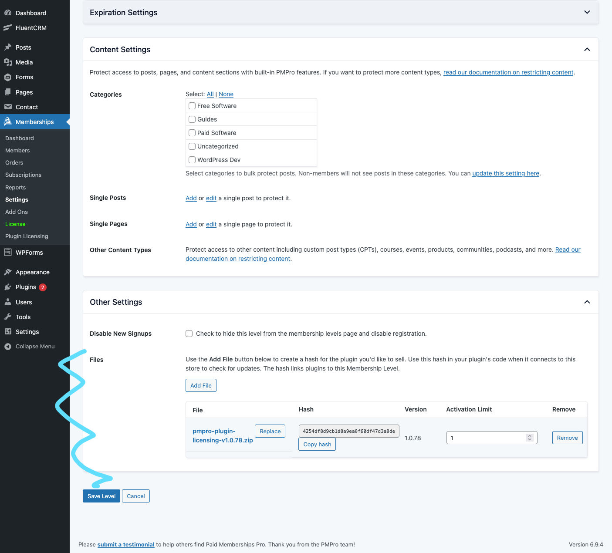
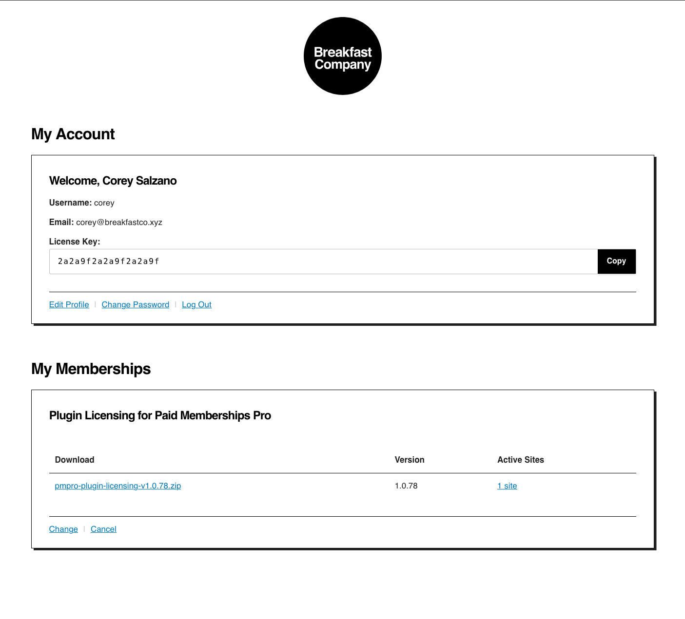
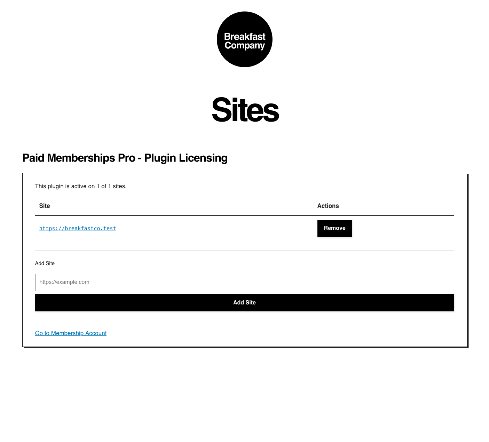

# pmpro-plugin-licensing

**Plugin Licensing for Paid Memberships Pro**

WordPress plugin. Add-on for Paid Memberships Pro. Helps sell plugin downloads, issue customer license keys, and deliver automatic updates to customer WordPress sites.

## Screenshots

### Screenshot 1



_When editing a Membership Level, the **Other Settings** manages file downloads and activation limits associated with membership._

### Screenshot 2



_A single license key manages all license and update requests to the store per user._


### Screenshot 3



_Users can add and remove sites from their licenses._

## What it does

- attach plugin `.zip` files to Paid Memberships Pro membership levels
- generate one reusable license key per customer
- validate whether a customer can download and update a given plugin
- expose REST endpoints that client plugins use for update checks and license activation
- give customers a membership account screen where they can manage active sites

## How it works

1. Upload a plugin zip file and attach it to a membership level.
2. When a customer purchases or is granted access to that level, the plugin issues a license key if needed.
3. The customer installs a client plugin that knows your store URL and file hash.
4. That client plugin calls your store's REST endpoints to check for updates and activate sites.

The companion sample client plugin lives here:

- [pmpro-pl-sample-plugin](https://github.com/breakfastco/pmpro-pl-sample-plugin)

## Setup

1. Install and activate __Paid Memberships Pro__.
1. Install and activate this plugin, __Plugin Licensing for Paid Memberships Pro__.
1. Edit a membership level at __Memberships → Settings → Levels__.
1. Find and expand the __Other Settings__ section.
1. Use __Add File__ to upload or attach a plugin zip. Use the __Replace__ button to provide users with an updated version.
1. Copy the generated file hash into the client plugin that should receive updates. Use the [sample plugin](https://github.com/breakfastco/pmpro-pl-sample-plugin) as a guide to integrate the updater into your plugin.
1. Instruct customers to enter their license key in the client plugin's settings screen. License keys are found on the PMPro __Membership Account__ page.

## Operational notes

### Downloads and access control

The plugin creates protected download URLs under:

`membership-account/download/<hash>`

Those links check whether the current logged-in user still has access to the file before serving the download.

The uploaded zip files themselves still live inside your WordPress uploads directory at `wp-content/uploads/pmpro-plugin-licensing/`, so you should treat upload delivery as part of your hosting/security setup too. In particular:

- protect `wp-content/uploads/pmpro-plugin-licensing/` from direct access at the server level
- make sure your uploads directory is not being exposed by a CDN or edge cache in a way that bypasses WordPress access checks
- use the protected WordPress download URLs instead of raw upload URLs when sending customers download links

Example Nginx rule:

```nginx
location ^~ /wp-content/uploads/pmpro-plugin-licensing/ {
    deny all;
    return 403;
}
```

### Multiple plugin purchases

If you want customers to buy multiple plugin products, place those membership levels in a Level Group that allows multiple selections. Otherwise a new purchase can replace access to an earlier level instead of adding to it.

### Invalid or expired licenses

An invalid or expired license does **not** remotely disable a customer's plugin code. This project is primarily enforcing:

- update eligibility
- license/site activation status
- access to protected downloads from the store

If you want a client plugin to gate features locally, that logic must live in the client plugin itself.

## REST API

Client plugins typically use these endpoints:

- `GET /wp-json/pmpro/v1/files/<hash>?site=<url>&license=<key>`
- `POST /wp-json/pmpro/v1/activate`
- `POST /wp-json/pmpro/v1/deactivate`
- `GET /wp-json/pmpro/v1/status?file=<hash>&license=<key>&site=<url>`

## Development notes

### License statuses

1. `invalid`: the license key was not found or the requested file is unknown
2. `expired`: the license is associated with a customer who no longer has access
3. `inactive`: the license is valid, but this site cannot be activated for the requested file
4. `active`: the license is valid and the current site is active for that file

### Force update checks

WordPress stores plugin update data in the `update_plugins` site transient. To force a fresh check:

1. `wp transient delete update_plugins --network`
2. `wp option delete _site_transient_update_plugins`

If you are testing the sample client plugin, also clear its cached store response:

`wp option delete pmpro_pl_sample_plugin_update_response`

### Useful database queries

#### List all file hashes

```sql
SELECT p.ID AS attachment_id, p.post_title AS title, p.post_name AS slug, p.guid AS file_url, pm.meta_value AS file_hash, p.post_date AS created_date, p.post_modified AS modified_date
FROM wp_posts p
INNER JOIN wp_postmeta pm ON p.ID = pm.post_id
WHERE p.post_type = 'attachment'
  AND p.post_status = 'inherit'
  AND pm.meta_key = 'pmpro_pl_hash'
  AND pm.meta_value != ''
ORDER BY p.post_title ASC;
```

#### List all license keys

```sql
SELECT id, user_login, user_email, meta_value
FROM wp_users
LEFT JOIN wp_usermeta ON id = user_id
WHERE meta_key = 'pmpro_plugin_licensing_license_key'
ORDER BY id ASC;
```
